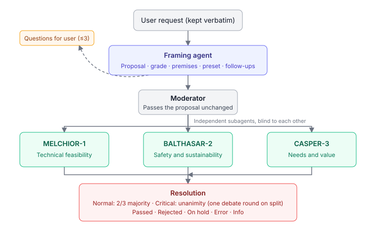

# MAGI — Three-Perspective Majority Deliberation Skill

Inspired by the MAGI system in *Neon Genesis Evangelion*.

A Claude skill that has three perspectives evaluate one proposal **without seeing each other's results**, then resolves it by a voting rule. The goal is to keep a decision from leaning on a single viewpoint and to keep dissent on the record instead of erasing it. The final decision always belongs to the user; the MAGI resolution is input to that decision.



> The skill is written in English, and MAGI answers in the language of your request. Ask in Korean and you get the result in Korean; you can also name a language explicitly (e.g. "answer in Japanese").

## Roles

| Role | Responsibility |
|---|---|
| Moderator (main conversation) | Gathers facts, runs the agents, tallies the vote, reports |
| Framing agent | Writes the proposal, grade, premises, preset, follow-up items, and questions for the user |
| MELCHIOR-1 · BALTHASAR-2 · CASPER-3 | Independent review (approve/reject, confidence, rationale, doubted premise) |

The agent that frames the proposal is separate from the one that summarizes the result, so judgment is not concentrated in one place.

## Resolution rules

| Grade | Criteria | Rule |
|---|---|---|
| Normal | Reversible, limited impact | Passes with 2/3 approval |
| Critical | Hard to reverse, or affects safety, security, data, or significant cost | Passes only if unanimous; on a split, one debate round and a revote; still split → on hold |

- Every vote is a plain approve or reject; there is no conditional approval. A condition is settled before the vote (checked as a fact, asked of the user, or proposed as a modified version), and advice for carrying out the decision is kept as a non-binding recommendation.
- If any unit objects to the grade, the item is raised to critical.
- If a unit fails, the other two do not vote alone; the result is reported as an **error**.
- When all three agree, shared premises and missing alternatives are checked once more.
- Questions that cannot be answered with approve/reject go to **information** mode: each perspective answers, with no vote.

## Presets

| Preset | MELCHIOR-1 | BALTHASAR-2 | CASPER-3 |
|---|---|---|---|
| Default | Technical feasibility | Safety and sustainability | Needs and value |
| Ethics | Consequentialism | Deontology | Virtue ethics and relationships |
| Code review | Correctness and design | Security, failure, compatibility | Readability and maintainability |
| Personal decision | Growth and capability | Risk and stability | Motivation and satisfaction |

The framing agent picks the preset unless the user specifies one. If none fits, it designs three new perspectives that can genuinely conflict.

## Installation

**Claude Code**

```bash
git clone https://github.com/jwsung91/MAGI.git
mkdir -p ~/.claude/skills
cp -r MAGI/skills/magi ~/.claude/skills/magi
```

**Claude app**

Zip the `skills/magi` folder and upload it with the Claude app's skill upload feature.

## Usage

```
/magi Replace keyword search with embedding search in the team wiki
/magi Open-source my side project next quarter
Decide with MAGI: should this PR go into this release?
/magi 이번 주에 운영 DB 스키마를 마이그레이션한다   # answered in Korean
```

Works best where subagents are available (Claude Code, or agent features in the Claude app). Otherwise the units are written one at a time, and the output says so.

## Result card

Where Claude can draw interactive visuals in the conversation (for example, the Claude app), MAGI adds a small result card after the Markdown result: the resolution, the three units' verdicts, and each unit's rationale on click. Elsewhere, such as Claude Code in a terminal, the card is skipped and the Markdown result is unchanged. Say "no card" to turn it off. The card is specified in [`skills/magi/references/card.md`](skills/magi/references/card.md).

## JSON output (optional)

In Claude Code, if the environment variable `MAGI_RESULTS_DIR` is set, MAGI also saves each result as a JSON file in that folder, so other tools can read it. The format is described in [`skills/magi/result.schema.json`](skills/magi/result.schema.json). Enum values are always English; free text follows the output language. Without the variable, nothing is written.

With the same variable, MAGI also writes a progress log, one JSON line per step, to `$MAGI_RESULTS_DIR/<run_id>.jsonl`. Follow a run live with `tail -f "$MAGI_RESULTS_DIR"/*.jsonl`, or read it afterwards.

To view results on a screen, see [MAGI-UI](https://github.com/jwsung91/MAGI-UI), a separate local viewer.

## Limitations

All three units come from the same model, so this is not true design diversity; common-mode failure remains. For important decisions, also get a review from other sources, other people, or another model.

## Notice

- This is an unofficial personal project and is not affiliated with *Neon Genesis Evangelion* or its rights holders. It only borrows the decision-making idea of the MAGI system from the series.
- No artwork, logos, or images from the series are included. `docs/flow.svg` is an original diagram made for this repository.
- [MAGI-UI](https://github.com/jwsung91/MAGI-UI) shows results on the screen of [TomaszRewak/MAGI](https://github.com/TomaszRewak/MAGI) (MIT), a fan recreation. It lives in a separate repository; this repository includes none of its code or graphics.

## License

[MIT](LICENSE)
